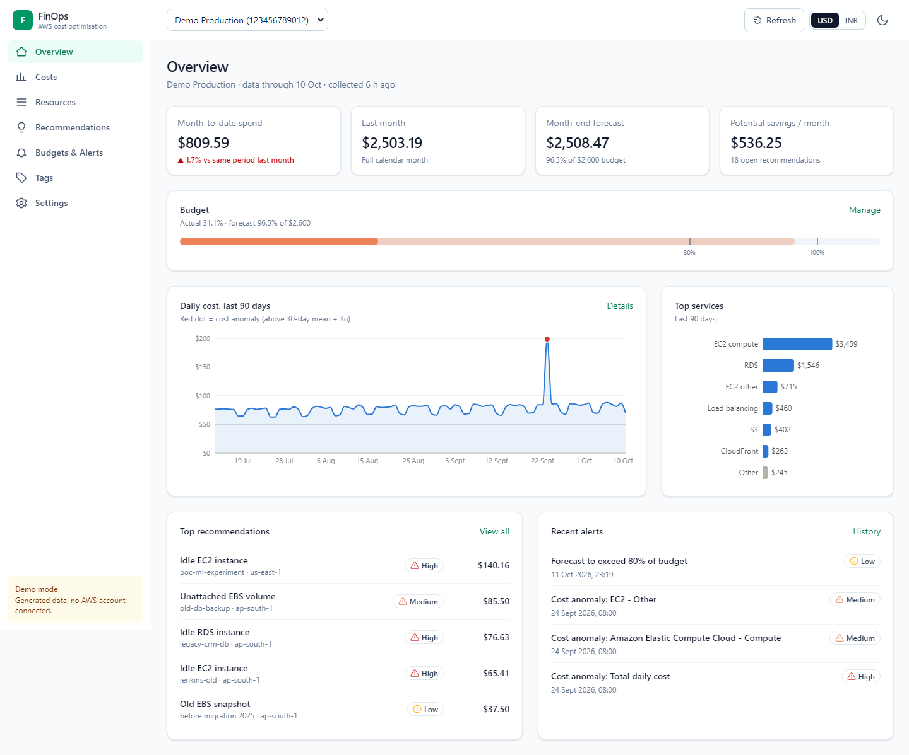
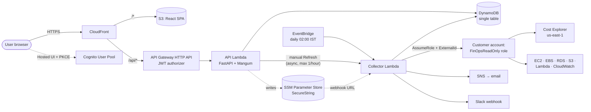

# Cloud-Native FinOps Platform

AWS resource monitoring and cost optimisation. The platform connects to an AWS account through a
**read-only IAM role** (STS AssumeRole + ExternalId), collects cost and resource data daily, detects
waste with 8 rules, estimates savings, forecasts the month-end bill, and alerts on budget thresholds
and cost anomalies via email and Slack.



**Highlights**
- Runs fully offline in **demo mode**: 90 days of realistic costs, 44 resources, a planted spike
- **No stored AWS keys**: cross-account access only via AssumeRole with a per-account ExternalId
- **Cost Explorer spend is controlled**: about 5 paid calls per account per day, and a manual
  Refresh limited to once an hour, enforced atomically in DynamoDB. Page loads never call it
  (a test proves this).
- Waste rules with configurable thresholds and no double-counted savings
- Forecast by numpy linear regression, compared with Cost Explorer's forecast
- Anomalies at mean + 3σ of the trailing 30 days; de-duplicated alerts
- Opt-in remediation behind four safety gates
- React dashboard: INR/USD toggle, dark mode, responsive, accessible charts
- 220+ automated tests (97% backend coverage), AWS CDK infrastructure, GitHub Actions CI

## Architecture



**Flow:**
1. EventBridge triggers the collector every night.
2. For each connected account, the collector assumes the customer's read-only role.
3. It scans every enabled region and enriches resources with CloudWatch metrics.
4. It prices each resource and reads Cost Explorer.
5. It runs the waste rules and evaluates budget and anomaly alerts.
6. Everything is stored in DynamoDB. The dashboard only ever reads from DynamoDB.

## Repository layout

| Folder | Contents |
|---|---|
| `backend/` | The `finops` package, shared by the API and the collector: `domain/` models, `repositories/` (in-memory and DynamoDB), `aws/` (session, costs, inventory, metrics), `collection/`, `rules/`, `pricing/` (`prices.json`), `analytics/` (forecast, anomaly, budgets, tags), `alerts/`, `demo/`, `api/` (FastAPI) |
| `collector/` | Thin Lambda entrypoint for the daily, EventBridge-triggered collection |
| `frontend/` | React 19 + TypeScript + Vite + Tailwind v4 + Recharts + React Router |
| `infra/` | AWS CDK (Python) stack, the Lambda build script, and `customer-templates/` (CloudFormation roles customers deploy) |
| `docs/` | [API reference](docs/api.md), [rules reference](docs/rules.md), [IAM design](docs/iam.md), [deployment guide](docs/deployment.md), [screenshots](docs/screenshots/) |

## Quickstart (demo mode, no AWS account needed)

Prerequisites: **Python 3.12** and **Node.js 22+**.

```bash
# 1. Python environment (repo root)
python -m venv .venv            # or: uv venv --python 3.12 --seed .venv
.venv\Scripts\activate          # macOS/Linux: source .venv/bin/activate
pip install -e "backend[dev]"
cp .env.example .env            # DEMO_MODE=true by default

# 2. API on http://localhost:8000 (Swagger UI at /docs)
cd backend
uvicorn finops.api.main:app --reload

# 3. Dashboard on http://localhost:5173 (second terminal; /api is proxied to :8000)
cd frontend
npm install
npm run dev
```

Demo data is generated in memory when the API starts, and its dates are relative to today, so the
demo always looks current. Useful presentation touches:
- Press **Refresh** twice to show the once-an-hour Cost Explorer rule (the second press is
  rejected with a retry time).
- Set `REMEDIATION_ENABLED=true` to show the remediation confirmation dialog. In demo mode the
  action is simulated.
- Paste a real Slack webhook in Settings and press **Send test alert** to show live Slack delivery.

To inspect or export the demo dataset: `python backend/scripts/seed_demo.py --json demo.json`.

## Development

| Task | Command (run from the folder shown) |
|---|---|
| Backend lint | `backend/`: `ruff check . && ruff format --check .` |
| Backend tests + coverage | `backend/`: `pytest --cov` (CI fails below 70%) |
| Collector tests | `collector/`: `pytest` |
| Frontend lint / types / build | `frontend/`: `npm run lint`, `npm run typecheck`, `npm run build` |
| CDK tests | `infra/`: `pytest` (separate venv: `pip install -r requirements-dev.txt`) |
| CDK synth (no deploy) | `infra/`: `npm ci && npm run synth` |

AWS is mocked with **moto** (STS, EC2, RDS, S3, Lambda, CloudWatch, DynamoDB, SNS, SSM). Cost
Explorer and the Pricing API are tested with **botocore Stubber**, which validates every request
against the real API definition; moto lacks `GetCostForecast`. Repository tests run against both
the in-memory and the DynamoDB implementations to prove they behave identically.

CI (`.github/workflows/ci.yml`) runs backend lint, tests and coverage; frontend lint, typecheck and
build; and the CDK tests plus synth. It never deploys.

## Deployment

See **[docs/deployment.md](docs/deployment.md)**. In short:

```bash
python infra/scripts/build_lambda.py
cd frontend && npm run build && cd ../infra
npx cdk bootstrap && npx cdk diff && npx cdk deploy
```

This creates DynamoDB, two Graviton Lambdas, API Gateway with a Cognito JWT authorizer,
EventBridge, SNS, Cognito, and S3 + CloudFront with OAC, all in ap-south-1 (Mumbai).

## IAM role design

Full details: **[docs/iam.md](docs/iam.md)**.

- **Customer read-only role** (`infra/customer-templates/finops-readonly-role.yaml`):
  - Trusts the platform's AWS account **only with the account's ExternalId**.
  - Allows Cost Explorer read; EC2, RDS and Lambda describe; S3 bucket *metadata*
    (no `GetObject`); CloudWatch metric reads; Pricing.
  - Role names must start with `FinOps`.
- **Platform roles** may assume only `role/FinOps*`, and have **no** Cost Explorer or EC2 rights of
  their own. All reads go through the customer's role.
- **Remediation** is a separate, optional role with three write actions
  (stop instance, snapshot + delete volume, release IP):
  - resources tagged `finops:protected` are excluded;
  - it is also gated by `REMEDIATION_ENABLED`, a typed confirmation, and an EC2 DryRun.
- **Secrets:** Slack webhooks live in SSM as SecureStrings and are never returned by the API.
  Configuration comes from environment variables (`.env.example`).

## Key design decisions

| Decision | Why |
|---|---|
| One shared `finops` package for API and collector | The schedule and the Refresh button run the same code path, so there is one place that calls Cost Explorer |
| Repository pattern (in-memory + DynamoDB) | Demo mode and fast tests with no AWS; one contract test suite checks both |
| DynamoDB single table `ACCOUNT#id / TYPE#...` | Every dashboard query is one `Query`; sort keys built from ISO dates make range queries trivial |
| Conditional writes for the refresh limit and alert de-duplication | Atomic: two clicks or two Lambdas can't both pass. TTL cleans up old dedup keys |
| Money as `Decimal`, stored in USD | DynamoDB rejects floats, and floats accumulate rounding errors. INR is a display conversion |
| Async manual refresh (API → collector Lambda) | API Gateway times out after 30 s; a multi-region scan can take longer |
| Linear regression with anomaly days excluded | Explainable, cheap, and robust to one-off spikes; compared with Cost Explorer's ML forecast |
| Anomaly = mean + 3σ **and** ≥ 20% / ≥ $1 above normal | Pure 3σ fires on tiny wiggles in very flat series |
| Static price table + optional Pricing API | Deterministic, offline, easy to update; live prices when wanted |
| One CDK stack | Deploys and rolls back atomically, with no cross-stack export lock-in |
| CloudFront serves the SPA and `/api/*` | Same origin: no CORS, one URL, HTTPS everywhere |
| Lambda on ARM64 (Graviton) | About 20% cheaper per GB-second |
| Fixed-order, colour-blind-validated chart palette | Identity never depends on colour alone; a legend, tooltips and a table view are always available |

## Roadmap status

All phases complete: scaffold, domain, collectors, rules and analytics, API, frontend, alerts and
auth, infrastructure, docs. Possible extensions: an SQS fan-out for many accounts, Savings
Plan/RI recommendations, more rules (idle NAT gateways, idle load balancers), and multi-tenant
workspaces.
